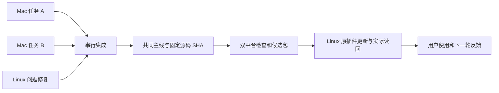

# Mac 并行开发与 Linux 持续候选交付

日期：2026-11-13。状态：第一阶段开发环境已实现，后续集成和交付接口仍为设计。
设计依据本次用户讨论及源码基线 `06c4719`；实施记录见 Mac 开发文档和任务回执。
本文定义目标流程、现有能力和实施顺序；不自动变更版本规则、验收门槛、推送权限或安装配置。

## 目标与机器分工

用户提出的改动通过相应交付检查后立即进入日常看板，不人为等待其他任务或集中发布日。
即时交付允许正常的验证、构建和更新耗时；不得将缺证解释成完整验收通过。

| 位置 | 职责 | 默认边界 |
| --- | --- | --- |
| MacBook 的任务 worktree | 主力开发、独立预览和测试 | 每任务一个目录、分支及私有运行环境 |
| MacBook 的固定原生测试入口 | 验证插件安装、嵌入界面及原生交互 | 同时一个使用者，不另开一批实验插件 |
| MacBook 的集成者 | 登记任务、审阅、重放改动、维护主线及触发交付 | 一次一个主线写入者 |
| GitHub Actions | 对指定源码做双平台检查、原生构建及候选发布 | 不连接用户桌面，不自动发布 stable |
| Fedora 日常实例 | 尽快使用候选并反馈 | 一个插件 ID，保留配置、数据库和备注 |
| Fedora 的临时 worktree | 定位 Linux/Fedora 特有问题 | 默认私有测试数据，修复返回同一主线 |

Mac 与 Linux 共用一个 `origin/main`，不维护两条平台主线。默认不要求每个任务创建 PR；
任务分支、结果记录及 diff 已足够交接，远端 PR 可作为可选审阅界面。

## 工具选择与已经具备的能力

| 环节 | 复用 | 尚缺的能力 |
| --- | --- | --- |
| 创建工作区 | Codex 原生 worktree、任务聊天、`dev setup` | 共享环境动作配置 |
| 业务预览 | 当前二进制、私有 fixture、`dev start/stop/status` | 新建会话等 fixture 场景扩展 |
| MCP 验证 | 当前 `mcp` stdio 入口及 `tests/native_authority/` | 将必要 fixture 从测试装配复用为开发装配 |
| 共享状态 | 现有 `context/` 所有权约定 | 任务结果中的交付阶段和主线映射 |
| 集成 | Git、现有检查钩子、本机 Agent 签名器 | 串行集成入口和改动重放记录 |
| 构建发布 | `build-plugin`、`publish_plugin.py`、双平台 CI | 不取消交付的调度和同源检查汇总 |
| Linux 更新 | `update_plugin.py`、固定产物 revision、更新锁、定向重载 | 按交付清单触发、恢复和校验最终回执 |

第一版不安装 Worktrunk，也不自建 Agent 调度平台。Worktrunk 的创建和合并 hooks 很贴近需求，
但默认 squash、自动提交和删除工作树，需要适配项目签名、规模规则及 Codex 的工作树生命周期。
先复用原生工具；以后若替换，必须只有一个工作树生命周期管理者。

MCP 官方 basic-host 是可复用的嵌入界面测试工具，但文档入口要求 HTTP MCP 服务，
本项目目前是 stdio MCP。不能直接把看板 HTTP URL 当成 MCP URL。
第一版使用现有网页预览和 stdio 协议测试，不为接入 basic-host 单独新增传输层。

## 开箱即用的任务环境

Mac 一次性准备 Rust、Clippy、Python、浏览器测试依赖和本机认证。机器路径、SSH 别名及凭据
留在本机配置；Git 中保存可移植的准备逻辑。Mac 使用 zsh，Fedora 使用 bash；
远端执行显式选择解释器，不依赖登录 shell 的历史默认值。

新任务由集成者记录目标、允许修改范围、基线 SHA、owner、worktree 和 coordinator。
使用 `codex/<task-id>` 分支，已有合适工作树可以复用；Codex 初始 detached HEAD 须先建立任务分支。
普通 Agent 无须自己决定安装哪个插件、使用哪个端口或如何连接用户桌面。

四个 `dev` 接口已可执行；`integrate` 和 `deliver` 仍待实现：

| 接口 | 契约 |
| --- | --- |
| `./scripts/dev setup` | 复用本机工具链，按 Cargo.lock 准备依赖及私有配置；不安装或重载插件 |
| `./scripts/dev start` | 运行当前业务实现与 fixture，输出私有预览地址及环境身份 |
| `./scripts/dev stop` | 核对本任务进程身份后退出，只清理本任务拥有的资源 |
| `./scripts/dev status` | 显示任务、源码、配置、端口、进程和 fixture 健康状态 |
| `./scripts/integrate TASK` | 集成者专用，审阅并重放指定结果，不隐含推送或部署 |
| `./scripts/deliver MANIFEST` | 在另行授予的交付范围内推进指定候选并核对 Linux 读回 |

下一阶段将 Codex local environment 的 setup 和动作接到这些入口；
通过桌面设置生成可共享配置，不猜写未核实的配置 schema。本阶段先使用终端入口。

每个任务独立保存配置、数据库及 WAL、项目登记表、历史和实时事件 fixture、
桌面/侧栏/control socket、预览/CDP 端口、浏览器 profile、打开命令记录、日志、报告和进程身份。
这些数据放在源码之外的任务专属目录，配置禁止回退至用户正式路径。
Mac socket 使用 `~/.csb-dev/<工作树路径摘要>/` 中的短私有路径，核验所有者和长度；
构建测试临时目录使用 `/private/tmp`。现有服务拒绝端口 0，首版采用实际就绪检测及有限重试，
处理释放探测端口后的竞争；
后续若支持持有预绑定 listener，须统一修改服务入口，不能仅按路径 hash 假定绝无冲突。

只在预览子进程中替换 Codex 状态路径和桌面环境，Agent 自己的登录与配置不受影响。
原生调用必须连接 fixture，打开命令只记录请求，远端连接关闭；fixture 缺失直接报错，
不得改连真实 `codex app-server`、桌面 socket 或生产数据。
复用同一 Rust 业务实现，只替换外部依赖，不维护第二套看板业务逻辑。

依赖下载缓存可共享，`CARGO_TARGET_DIR` 各任务独立，避免共享可写构建目录的锁争用和产物混用。
首次实现不引入额外编译缓存服务；依赖变更由 setup 按锁文件补齐，不重装整台机器。
这里防止正常流程误用环境，同用户的完整 shell 权限不构成系统安全沙箱；需要硬隔离时单独设计。

## 原生测试宿主与任务交接

多数改动在私有预览和协议测试完成。必须验证插件入口、嵌入行为或真实原生交互时，
领取 Mac 原生测试入口的独占使用权，记录任务、源码、PID/启动身份、唯一令牌和当前包。
所有原生操作核对令牌，旧任务失去租约后不能继续安装、写入或清理新持有者的资源。
会话结束或进程失效后核实实际状态再回收；不能因一个时间戳过期就抢占仍工作的任务。
测试结束恢复固定的集成候选，保留回执；原生证据绑定实际包及二进制 SHA。

若运行 Agent 的 Codex 同时也是测试宿主，重载可能影响正在使用该 MCP 的任务；
领取前检查占用，无法安全重载时等待或使用独立宿主。不能假定同机第二实例天然隔离。
自动重启整台 Codex、全局刷新其他插件及修改无关桌面设置不属于开发准备。

worker 小步验证和提交，只写自己的任务/结果记录。共享 STATE、阶段、全局日志和任务登记
由集成者更新；并行任务不分别修改同一份全局状态再要求 Git 猜测正确结果。
交接须给出 base/tip SHA、修改范围、验证命令与结果、外部证据缺口、数据兼容性、
是否需要原生测试，以及面向用户的预期变化。报告放在源码之外，结果记录引用其路径和摘要。

## 主线、版本与签名

集成者是一个职责，不要求常驻 Agent。默认由 Mac 当前协调会话担任，
同一时刻只有一个会话获准写主线及共享 context；任务可并行，主线提交不能并行。
本机锁只保护本机事务，不能证明另一台机器未在集成。
Linux 热修交给同一集成者，紧急修复优先于尚未开始集成的普通项。
Mac 不可用时先确认原集成者停止，记录所有权交接；无法确认时仅保全任务分支，不抢写主线。

当前规则要求每个提交升版并检查全部可达历史。规则修改前：

1. worker 继续准备版本、暂存、审阅、运行 `check --pre-commit`，由现有钩子执行 Clippy 和测试。
2. 集成者从干净主线准备候选工作区，逐个重放任务提交的实际改动，并记录来源 SHA。
3. 重放时仅将自身版本字段恢复为新父版本，保留清单及锁文件中的依赖变化；
   再准备下一版、检查规模和内容，通过同样门禁后签名提交。
4. 原任务分支保留作追溯，不直接合入版本步进冲突的历史，也不将整个大任务 squash 绕过规模限制。
5. 末次检查及新提交验签通过、主线基点未变化才快进；主线变动则重做受影响的候选和验证。

签名提交必须使用本机已有的 `agent-git commit`；不存在时按现行本机签名约定处理，
不更改用户全局配置、不复制其他主机密钥。重写提交后原签名不再证明新提交，须重新签名。
普通 `git rebase` 不能替代当前“重放、重新计算版本、重新检查和签名”的完整步骤。
现有 `check` 不等于签名验真，集成者另行核对新提交的签名及本机登记身份。

目标规则建议改为开发提交以 SHA 标识，产品版本只在准备候选时推进。
需单独实现并审阅明确的 Git 切换点：旧历史沿用旧规则，之后的开发提交允许版本不变，
候选准备提交必须按现行进位规则同步四份清单且不可复用已发布版本。
同步调整检查器、钩子、CI 发布触发及文档；保留历史检查、签名、13 文件/400 行限制和全部验收断言。
普通开发提交不发布同版本的不同产物。该规则上线前，执行上面的现行规则兼容路径。

集成冲突由原任务负责解释和修复；公共接口耦合任务先约定接口或顺序实施。
干净候选经审阅后才能推进主线，不能 stash/reset 用户改动来制造干净工作区。
main 已被另一工作树检出时由其持有者执行快进，不直接移动仍被检出的主线引用。
远端主线使用正常快进推送和预期父 SHA 校验，不强推；竞争失败回到集成阶段。

## 每项改动的交付

状态按证据推进：开发中、待集成、已集成、候选构建中、待 Linux 更新、已加载、
问题复验通过、完整验收待验证或通过。分支自动检查通过只表示待集成，不能报告整项开发已验收完成。

1. 一个任务准备好就立即集成，无等待其他任务的批次窗口。
2. 固定集成源码 SHA，执行双平台必需检查和自动验收；在同一 SHA 上原生构建并保存确定的包。
3. 核对两平台包的源码 SHA、版本、指纹、冻结需求摘要及包摘要；包齐备后发布不可变候选 Release，再写入渠道并固定各自产物 revision。
4. 双平台候选发布完成后，立即触发 Linux 更新，不等待其他开发任务完成。
5. Linux 上复用现有更新器和安装锁，核对回执与实际 MCP/页面后，向用户报告可体验的具体变化。

现有 `./scripts/release candidate` 和 `--local` 共用保存、复用及发布逻辑。
失败重试继续消费已经保存的原包，同版本不同源码或不同包拒绝覆盖。
稳定提升复用候选包，仍须完整验收证据；具体命令见 [部署说明](DEPLOYMENT.md)。
任务串行集成与 Linux 更新封装仍按本设计后续实施，不把发布入口等同于整套自动交付。

交付清单放在源码之外，含任务、源码 SHA、源版本、各平台产物 revision/摘要、
对应 CI 结果、需执行的目标机复验及上一已确认版本。
源码提交 SHA 与产物分支上的 Git revision 是不同字段；`--revision` 接受后者。
选定产物 revision 后还须核对包内 `source_commit`，不把移动的 candidate 分支名当唯一身份。

首选由 Mac 集成者通过已有授权的远程连接，触发 Linux 上本机更新入口；
实施前实测 Mac 到 Fedora 的认证、解释器、桌面 socket 和定向重载能力。
不把 Mac 配置、数据库、插件缓存或凭据同步到 Linux，Linux 自己获取本机平台包。
若通道不可达，保留精确交付清单并交给 Linux 当前会话继续，不自动新增常驻服务或凭据。
无需把 Linux 源码检出切到所有候选；固定产物更新不依赖本机 HEAD。
现有 `scripts/update-plugin` 会要求候选源码等于本机 HEAD，保留该保护；
面向消费者的封装调用 `update_plugin.py --revision ...` 并独立核验清单。

候选发布及安装中的工作不因后续 main 提交被取消。现有 CI 按源码 SHA 区分
concurrency group，并设置 `cancel-in-progress: false`，不同提交可独立构建和保存包。
这不提供跨提交先进先出的发布队列，串行集成者仍负责安排最终交付次序。
不同平台产物保持独立发布锁和版本单调性；旧运行不得覆盖更新的候选。
GitHub 队列不保证按源码先后取得执行权，发布前比较源提交祖先关系和现有通道版本，
已被新版本覆盖的交付记录为 superseded，不改写通道或自动降级客户端。

## 实际加载、故障与回退

Linux 更新同时核对：包的平台与源码身份、插件缓存哈希、预期插件 ID、
`serverInfo.version`、`board_view`、`desktop_loaded=true` 及成功 phase。
实际调用桌面工具，并将 HTTP 的 build/configId/dataDir 与目标包和升级前配置对应。
旧会话可能继续持有旧 MCP，安装回执或仅有工具目录不能代替运行时读回。
随后验证原看板入口和本次改动相关的可见行为；CLI 退出 0、文件复制完成都不足以证明加载。
定向重载能完成时不重启用户整个 Codex；无法完成时报告阻塞原因。

当前更新器发生重载失败时，错误可能保存在 `current.json` 的 phase/reload_error，
且正常返回路径会删除 `pending.json`；不能只凭 pending 是否存在判断成功。
恢复操作先读回实际安装和运行状态，再继续同一固定 revision，不重复创建市场或盲目安装。
任务 A 的读回失败应先处理到明确结果，再开始任务 B 的安装。
重复交付同一身份应复用已有包并补读回，交付新版本前防止旧清单导致隐式降级。

| 故障 | 行为 |
| --- | --- |
| 分支或集成检查失败 | 留在该任务，其他独立任务继续；不推进主线 |
| 一个 CI 平台失败或只发布了单边产物 | 不声称双平台通过，不自动切换 Linux；按固定源码修复或重试 |
| Mac 睡眠、网络断开 | 保留源码及产物身份，恢复后续跑；Linux 继续用当前版本 |
| 桌面 socket 缺失或重载失败 | 保留回执和实际状态，报告待加载，不自动重启桌面 |
| 新版运行异常 | 固定上一已确认产物 revision 回退，读回实际版本 |
| 数据格式不支持向后读取 | 停止自动回退；按迁移方案保护升级后的新数据再恢复 |

配置、所有本机和远端子库、WAL 中已提交备注由现有运行时备份路径保护。
回退前须核对备份与升级后新增数据；回退程序不等于回退数据库。
不清理历史 release、正式数据路径或未交付工作树来腾空间。

## Linux 特有问题与验收

本机 Agent 先记录实际运行包和源码、桌面版本、系统、复现步骤和相关日志，
从对应版本建立独立任务工作区。能用 fixture 复现则隔离修复；必须读真实状态时限制读写范围。
需要真实写入或重载时，和更新流程共用同一宿主占用控制，优先使用专用测试会话。
用户当前报告的问题作为本机复验项；Ubuntu CI 不能代替 Fedora/Wayland 的真实闭环。
修复返回共同主线并检查 Mac 回归，不把 Linux 本机未合入补丁作为长期安装来源。

个人候选交付沿用既有 candidate 机制，记录自动结果和外部证据缺口。
对外 stable 必须按原 31 条及原生/远程扩展验收，退出 0、`release_ready=true` 且证据内容经审阅。
新增 fixture 或候选交付回执不代签原生证据；修改源码、版本或参与指纹的文档后，
旧指纹证据不得复用。本文只完成流程设计，不签收业务功能。

## 分步实施与签收

每步独立实现、验证和提交。推送、远端配置及真实插件更新在实施任务中明确授权后执行。

| 顺序 | 交付 | 必须验证 |
| --- | --- | --- |
| 1 | `dev setup/start/stop/status` 和原生依赖 fixture | Mac 两任务同时完整交互，数据/端口/进程互不影响，正式环境零改动 |
| 2 | Codex local environment 与 setup 复验 | 新 worktree 不改路径即可运行；依赖冷/热启动、重复 setup、删除工作树后恢复 |
| 3 | 串行集成入口，先兼容当前规则 | 三任务同基点，含相同版本和源文件冲突，逐提交签名/版本/规模门禁通过 |
| 4 | 版本规则正式切换 | 旧违规历史仍拒绝；新开发提交可不升版；候选必须升版且不可重用产物 |
| 5 | CI 发布调度和固定交付清单 | A 构建时合入 B 不取消 A；乱序完成、单边失败、重复发布和新旧竞争均有确定结果 |
| 6 | Linux 触发与读回封装 | 同 ID 原地更新、备注保留、socket 丢失不假成功、重试不降级、固定版本回退 |
| 7 | 端到端试运行 | 三任务并行加一个 Linux 热修，先完成者先体验，其他任务不中断，无多余插件安装 |

第一阶段已在两个 Mac 工作树验证：真实页面拖拽、不同备注、导航记录、刷新、
停止 A 时 B 继续写入、A 重启保留数据、fixture 崩溃只关闭本任务以及幂等操作。
进程守护者持有进程组，清理确认后才报告停止；健康检查在同一 TCP 连接核对身份并读取会话。
开发 fixture 证据不替代完整 31 条业务验收。取证期间另一个已授权任务更新了两端正式插件；
运行前后快照按窗口比较，不能把不同发布版本解释成正式环境全程未变。

首轮测量 setup 冷/热耗时、分支验证、排队、CI、下载、重载、可见行为复验的各段耗时。
结果记录任务 ready、main、包 ready、Linux loaded 的时间点；没有实测前不承诺分钟级上限。
后续只优化实际瓶颈，不以跳过测试或人工取证制造速度。

## 来源与后续维护

现有实现依据：`src/main.rs`、`src/config.rs`、`src/projects.rs`、
`tests/native_authority/`、`scripts/update_plugin.py`、`scripts/reload_plugins.py`、
`scripts/publish_plugin.py`、`.github/workflows/plugin-candidate.yml`。
规则依据：`AGENTS.md`、`Docs/CHECKS.md`、`Docs/MAC-DEVELOPMENT.md`、
`Docs/DEPLOYMENT.md`、`acceptance/README.md`；冲突时当前已启用规则优先。

2026-11-13 核对的外部一手资料：

- OpenAI 官方 `Worktrees`：`https://learn.chatgpt.com/docs/environments/git-worktrees`。
- OpenAI 官方 `Local environments`：`https://learn.chatgpt.com/docs/environments/local-environment`。
- Worktrunk 官方 `wt merge`：`https://worktrunk.dev/merge/`。
- MCP 官方 `Testing MCP Apps`：`https://apps.extensions.modelcontextprotocol.io/api/documents/Testing_MCP_Apps.html`。
- GitHub 官方 `Concurrency`：`https://docs.github.com/en/actions/concepts/workflows-and-actions/concurrency`。
- GitHub 官方 workflow syntax：`https://docs.github.com/en/actions/reference/workflows-and-actions/workflow-syntax`。

实施各步时更新本设计中的现有/待实现状态，并在任务结果中链接真实运行证据。
