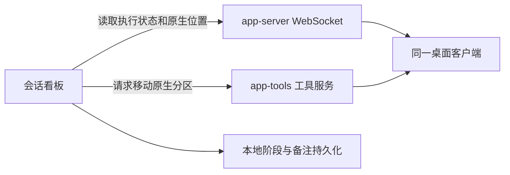

# Codex 会话看板 socket 反复失效调查与长期修复方案

调查日期：2026-11-11，Asia/Shanghai。对象是 Fedora 本机正式看板 v0.2.73 与当前桌面客户端。本文是调查与实施方案，不是已完成修复的声明。

结论：本机两套自定义四小时清理器存在可稳定复现的缺陷，会把仍在服务的 socket 目录判成可递归删除对象。用户清理执行与本次首条连接失败日志相隔约十秒，是目前最有证据支持的触发因素，但缺少目标级审计，不能确证历史删除的责任进程。

长期方案应先修正这两套清理策略，再补齐实际监听端的自修复与客户端发现能力。看板重试无法重新创建另一个进程的监听入口；更换 UUID 或稳定符号链接不能独立完成修复。后续再验证公开原生 API 能否减少私有移列依赖。

## 1. 要解决的问题和交付标准

用户需要会话实际执行、暂停和结束后，看板与原生状态分区自动跟进；桌面重启、升级、端点改名和路径意外消失后，不再需要人工查 UUID、改配置或重启整套客户端。

长期方案应通过明确的故障注入和独立读回验收。建议正常执行阶段在 10 秒内反映，服务恢复可用后在 30 秒内完成重新连接和仍有效阶段的补偿。这两个数字是待实施的验收目标，不是当前性能承诺。

同时保留原生分区权威、人工后续选择、备注和输入复核保护。连接失败不得冒充状态保存成功，无法确定目标实例时不得猜测写入。

## 2. 本次已确认的事实

| 证据 | 观察结果 | 可以得出的结论 |
| --- | --- | --- |
| 桌面实时 thread/list | 重命名调查会话和本诊断会话均为 active | 确有正在执行的本机会话 |
| 原生位置及正式 /api/sessions | 前者仍在待审阅，后者仍在待判断 | 状态更新失败已经影响实际使用 |
| 生产库只读查询 | 新轮次的 runtime_pending_key 目标均为 in_progress | 新执行已通过阶段判断并排入更新队列 |
| 正式健康信息 | runtimeVerified、nativeVerified 为 true，nativeStageError 持续非空 | 运行和位置读取正常，移列写入失败 |
| sidebar_socket 配置地址 | 旧 UUID 文件及其父目录不存在，connect 返回 ENOENT | 该地址不能建立新连接 |
| ss -xlpn | 桌面 PID 2505572 仍监听另一个 app-tools UUID 地址 | 监听进程存活不等于路径仍可连接 |
| 对新 UUID 路径实际 connect | 同样 ENOENT，两个标准发现目录均不存在 | 修改为 ss 显示的新 UUID 也不能恢复 |
| 挂载命名空间 | 桌面、看板、诊断进程一致 | 本次不是两个进程看到了不同 /tmp |

01:43–01:47 已确认上述反例。02:14、02:26 再查，正式服务仍为 v0.2.73，自动移列错误仍存在。
02:29 的独立连接探针确认 app-server 读取连接可用，对端 PID 2506017、UID 1000；app-tools 写入连接仍返回 ENOENT。

当前证据能确认“监听地址在文件系统中不可达”。尚不能确认路径被谁删除、是否发生过目录改名、具体发生时间。不得将 ENOENT 直接归因于系统清理程序。

## 3. 两条连接必须分开处理

| 配置 | 当前入口 | 实际情况 |
| --- | --- | --- |
| desktop_socket | /run/user/1000/codex-desktop/app-server-bridge/app-server.sock | 符号链接，目标仍在 /tmp/codex-daemon-1000/ 下，本轮可连接 |
| sidebar_socket | /tmp/codex-app-tools-1000/旧UUID.sock | 本轮路径及目录不存在；新 UUID 地址也不可达 |

因此 runtimeVerified=true 和 nativeVerified=true 不能代表自动移列可用。
当前界面同时显示“自动状态已连接”和“自动状态更新待重试”，用户很容易把前一句理解成完整状态流转正常。
健康状态需要直接说明哪项能力失败、何时首次失败、最后成功写入时间和待处理会话数量。

把入口名称改成固定名字、加一个符号链接，或者在 /run 下做一个仍连接失效 /tmp 地址的转发器，都没有修复实际监听端。

## 4. 为什么以前修过，今天仍会坏

| 时间及记录 | 当时验证的故障 | 已有修复的有效范围 |
| --- | --- | --- |
| 11 月 7 日 socket-recovery | 客户端退出，旧 socket 文件仍在但拒绝连接；重开后出现新 UUID | 看板重新发现唯一存活端点；实际桌面强退重开后约 15.4 秒恢复，并验证后续真实执行阶段 |
| 11 月 9 日 sidebar-uid-directory | 升级把 codex-app-tools 改为 codex-app-tools-UID | 兼容两个标准目录；读取真实新端点并恢复状态 |
| 11 月 10 日 daily-native-deploy、deploy-board-ui | app-server 稳定入口的符号链接目标不存在 | 部署记录明确保留该异常；不是“所有连接都恢复”的证据 |
| 11 月 11 日本次现场 | app-tools listener 仍活着，但新旧地址与两个发现目录均不可达 | 当前消费者重发现没有可连接目标；此前崩溃重开验收没有覆盖此类故障 |

这些历史修复各自解决了实际问题，但没有形成覆盖两种服务端点整个生命周期的验收。
特别是“旧端点失效后已出现新端点”和“端点消失后服务端没有重建入口”需要两种不同处理。

## 5. 已执行的隔离复现

在独立临时目录创建 AF_UNIX listener，并建立一条连接，然后只删除该测试 socket 路径及其父目录。没有操作生产端点。

| 操作或探针 | 实测 |
| --- | --- |
| listener 的 SO_ACCEPTCONN | 仍为 true |
| getsockname | 仍返回原来的地址 |
| 已建立的连接发送和接收 ping | 成功 |
| 再创建一条连接 | ENOENT |
| 只重建同名目录，再连接 | 仍为 ENOENT |
| 由测试监听端重新 bind/listen，再连接 | 成功 |

这证明现有现场在 Unix socket 机制上完全成立，并解释了“进程还在，ss 还在，功能却持续失效”。
旧连接仍能通信、进程 PID 不变、文件名出现在 ss，都不足以作为新连接可用的健康条件。
消费者无法通过 mkdir、touch、换 UUID 或无限扫描来重新制造另一个进程的监听对象。

## 6. 已定位到可复现的本机清理缺陷

本机同时启用了两套自定义 tmp-autoclean.timer，均每 15 分钟触发一次，以 240 分钟为清理阈值：

| 范围 | 实际执行文件 | 筛选范围 |
| --- | --- | --- |
| 用户服务 | /home/herman/.local/bin/tmp-autoclean.sh | /tmp 顶层、属于当前用户、mtime 超过 240 分钟的条目 |
| 系统服务 | /usr/local/bin/tmp-autoclean.sh | /tmp 顶层、所有用户、mtime 超过 240 分钟的条目 |

两份脚本第 16 行的排除名单都没有 codex-app-tools 或 codex-daemon。
第 22 行只执行 `fuser -s "$p"` 检查顶层路径；第 27 行随后递归删除整个目录。
第 30 行的候选筛选只看该顶层条目的 mtime，不能证明其中没有仍在使用的对象。
它们是本机自定义服务，不是 Fedora 默认的 systemd-tmpfiles 清理。

主代理用独立临时目录复现了同一判断流程，未运行两份真实清理脚本：

1. 在目录内部建立真实 listener 和连接，完成 ping 通信。
2. 将测试目录的时间戳设置为 241 分钟前，以模拟长时间运行。
3. 相同 find 谓词选中了这个目录。
4. 对目录执行 fuser 返回 1；对其内部 socket 执行 fuser 返回 0。
5. 正常通信没有刷新目录 mtime。

因此，“超过四小时且 fuser 没发现目录使用者”不能作为递归删除该目录的安全判断。
这项缺陷已经被实测证明，修复它不需要等到完全追溯历史删除者。

### 与本次故障的时间对应

| 本地时间，2026-11-10 | 记录 |
| --- | --- |
| 19:26:33.194080 | 桌面 PID 2505572 记录 dynamic_app_tools_listening，地址为本次丢失的新 UUID |
| 23:31:57.831730 | 用户级 tmp-autoclean.service 开始 |
| 23:31:58.119109 | 用户级清理结束；同秒日志记录 removed=1、age=240min |
| 23:32:08.196770 | 同一客户端首次可读日志记录对该 UUID 的 connect ENOENT |
| 23:32:17.844594 起 | 下一次系统级自定义清理开始，已经晚于首条 ENOENT |

创建到用户清理约四小时五分钟；用户清理结束到首条 ENOENT 约十秒。
结合误删机制，用户级四小时清理是本轮最有证据支持的触发因素。
但 removed=1 只表示一次 rm -rf 分支返回成功，没有记录目标名称，目标已不存在时也可成功。
因此不能宣称已查获历史删除的责任 PID。此前系统级清理也缺少目标级日志，不能全部排除。

Fedora 默认规则 `/usr/lib/tmpfiles.d/tmp.conf:11` 对 /tmp 使用 10 天阈值。
当天默认系统清理约 20:26 执行，距离新端点创建不足一小时，不支持把本次四小时故障归因于该默认规则。
当前没有证据证明旧的无 UID 目录在本轮曾存在，不能推断两个发现目录是同时被删除。

## 7. 端点所有者的恢复责任

已核对安装的 app.asar、缓存官方原包及社区包装器源码。
app-tools 的创建、监听和关闭片段与官方 26.1103.60933 原包逐字节一致。

| 组件 | 已核实的实现 | 修复归属 |
| --- | --- | --- |
| app-tools listener | Electron 创建一次 UUID 地址并 listen；运行期没有路径巡检或重绑，首次失败只记 warning | 官方 Electron 实现，或社区发行版中经验证的对应 feature 补丁 |
| app-tools MCP 客户端 | 首次缓存环境路径，断开后重连仍使用原路径 | 官方 codex-app-tools 客户端的发现与连接机制 |
| app-server 桥 | ensureAuthority 在子进程存活时直接返回，不检查 alias/目标是否仍能新连接 | 社区 shared-app-server-socket feature |
| app-server 真实 listener | 当前位于 /tmp/codex-daemon-1000；所查官方 main 的 accept 循环未包含路径丢失重绑 | 官方 CLI listener；main 只能作设计参考，实施前须匹配安装版本 |

app-tools 路径硬编码在 /tmp，启动时还会清除继承的 CODEX_APP_TOOLS_PIPE_PATH，再发布自己创建的地址。
因此设置旧环境变量、单改 TMPDIR、用父目录 symlink 改位置都不能完成此项修复。
它的 close 只清理文件，不删除父目录；没有发现能直接证明本轮目录由客户端自己删除的代码证据。
close 的所有权保护只有布尔标志，没有 inode/代次校验；退出资源栈也未等待其异步完成。这些是补齐重绑时应处理的缺口，不能冒充本轮已发生的竞争。

app-server 桥在安装文件 `update-builder/linux-features/shared-app-server-socket/patch.js:154` 中存在上述早返回。
它已有退出时 inode 校验；现有 socketPathIsLive 只用于死亡 owner 的旧锁回收，不能证明运行中有恢复。
官方 main 的实现还说明 --listen unix://PATH 可以只是公布的 alias，真实 bind 位于受保护的 /tmp 目录。
移动真实目录必须保留对特权 RPC socket 的沙箱隐藏边界，不能简单换一个路径字符串。
若现有 CLI 没有无损重绑能力，杀死 authority 再启动会影响执行，不能作为满足“不打断任务”的修复。

实际社区维护仓库为 `/home/herman/Projects/codex-desktop-linux`。
安装元数据记录社区 commit a99cbc9591c4、构建时 dirty=true；不能把当前 checkout HEAD 当作已安装包的完整指纹。
修复应进维护仓库并随 RPM、feature 补丁和 update-builder 一起交付。只改 /opt 或开发 checkout，都不能证明后续自动更新会保留修复。

复核坐标是安装 app.asar 的 `.vite/build/early-bootstrap-815-e030c49be4b9c405.js`：
start 在条目 byte 579441，close 在 580465，app-tools 创建在 4876384。偏移从 0 开始。
对应 app.asar SHA256 为 `23529d915340b1e821e98e6380ea9c9cfd8bde9327f236a5d1453cd24646fa03`；升级后须重新核对语义锚点，不能继续盲用偏移。
安装桥补丁 SHA256 为 `6b3f478fb1d804e3019d82e0f38ff3ebb54553cea1253dd2fcfe2f486aff270c`。

## 8. 推荐的长期修复顺序

### 第一步，修正清理策略

首选停止并禁用上述用户、系统两套 tmp-autoclean.timer，普通 /tmp 清理交回现有系统机制。
两套都要处理，只改用户脚本会留下系统级同类删除能力。
核对两套 timer 已禁用且不再调度，并确认没有正在执行的清理进程，然后才恢复客户端入口。
oneshot service 显示 inactive 只能证明当时没有执行，不能证明 timer 已停用。
保存原脚本、unit、timer 状态和相关日志作为回滚与取证材料。这里的停用是实施建议，本次尚未执行。

如果四小时回收本身必须保留，应限定到应用明确声明为可删除的 scratch/cache 根目录。
清理者只管理自己的数据，使用应用生命周期锁或明确的空闲标记，不递归清理任意 /tmp 顶层目录。
优先复用现有 systemd 目录管理能力，避免再维护一套与系统默认清理重叠的通用删除器。

为 Codex 两种目录增加排除项可以作为过渡措施，但不能证明通用清理算法已正确：
换一个 IPC 目录名或换一个应用仍可能复发。只延长阈值会推迟同一故障。
增加 /tmp 排除规则也不能约束其他脚本直接执行的 rm；必须修正实际执行删除的两份脚本或停用对应服务。

### 第二步，让监听所有者能够恢复端点

实际 listener 与端点目录应由同一层明确管理。为两种服务分别检查真实绑定路径，而不只检查固定入口或符号链接。
优先使用用户运行时目录，检查所属用户、目录权限和对端身份；不能把换目录本身视为全部修复。
XDG 规范允许运行时目录内文件被周期清理，任意外部删除也仍可能发生。

建议服务端具备以下契约：

- 每代监听具有独立身份，包含 host、account、owner PID 与进程启动标识、端点及协议版本。
- 启动成功后发布可验证的当前端点；进程存在或旧连接活跃不代表健康。
- 通过新连接的只读握手检测入口，检测路径删除、改名或父目录消失后重新绑定并重新发布。
- 目录事件监听要处理自身失效；用有界周期探针兜底，避免 watch 失效后不再检查。
- 清理只处理自己这一代的端点，核对 inode/代次，不能由旧退出回调删除新实例端点。
- 端点恢复只重建通信入口，不终止模型任务、不自动重启整个桌面。

这项服务端能力修复路径意外消失后的恢复缺口；第一步消除本机已经确认有缺陷的触发机制。
两者分别解决触发与恢复问题。

### 第三步，收紧看板的连接与健康契约

看板保留现有安全重发现、人工选择与 pending 保护，补齐端点代次核验和能力状态。
连接层按可恢复故障退避重连；状态操作仍遵循写前核对、写后读回，丢回执不盲目重放。
新执行阶段可以接替旧 pending，后来人工选择不能被旧阶段恢复覆盖。

把“运行读取可用”“原生位置读取可用”“原生移列入口可用”“最后一次移列已确认”分开显示。
同一原因只显示一条清晰故障，附首次失败、持续时间和受影响数量，不累加重复文字。
endpoint 不存在时说明需要服务端恢复入口，不以持续重试暗示它已经能自愈。

## 9. 原生 API 迁移的独立决策门槛

当前官方 App Server 文档已公开 threadSection/list 等分区方法和 thread/section/move。
它还提供 thread/list 的运行状态和 thread/status/changed 通知。
历史文档中“没有公开分区协议”的描述不能作为当前选型依据。

桌面使用的二进制为 `/opt/codex-desktop/resources/codex`，版本 0.167.0-alpha.3.2；PATH 中 CLI 为 0.167.0。
两者默认生成的 schema 均包含分区增删改查、移动、分区变更及执行状态通知，不只在实验输出中出现。
02:35 的真实只读探针确认，桌面返回的六个状态分区与 hostSectionIds.local 一一对应，抽样 list/read 的分区一致。
因此不能继续把“两套 ID”直接等同于“两套独立 authority”。

但存在公开方法和正确读取映射，不等于已经验证外部写入能被当前桌面界面采用。
11 月 7 日曾实际出现“后端写入读回成功，侧栏位置没有变化”的反例；应在当前版本重新核对。
本次只读调查不能代替受控写入验收，也没有在用户工作会话上试写。

后续应在专用可恢复会话上完成以下决策实验：

1. 明确桌面逻辑分区 ID、host 后端分区 ID、会话别名和真实 ID 的映射，不能仅凭名字猜测。
2. 经原生 RPC 移动一次，独立读取 thread/read、真实侧栏和看板，核对三处确实一致。
3. 经桌面手工移回，验证原生 RPC 的读取与通知能反映外部修改。
4. 重启和升级后重测，覆盖多个 host、未分区、Pinned、自定义分区和新建别名。

若全部成立，优先统一到当前原生 API，删除 app-tools 移列依赖，减少私有协议维护。
若不成立，保留桌面权威语义，修复 app-tools 的监听生命周期，并把受控反例交给实际接口维护方。
只开一个新 app-server 读历史不能证明连接了当前桌面的运行 authority。

分区移动对应 thread/section/changed，执行对应 thread/status/changed，不能用一个替代另一个。
当前看板 RPC 忽略这些通知；事件订阅可降低延迟，仍需重连后的全量读回，不能单凭通知推断完整历史。
原生协议没有条件写修订号，不能宣称消除了两次读取之间的竞争或提供原子 CAS。
远程操作需要连接正确主机并使用该主机映射，不能假定本机 API 接受任意 hostId。
即使移列迁移成功，项目读取及移动仍有 app-tools 调用，不能宣称整个程序已摆脱该依赖。

不建议为躲开连接故障改成本地看板状态获胜。这会改变已确认的原生权威要求，并重新引入双向对账冲突。
单独增加一个转发到旧临时地址的 sidecar，也不能让已消失的上游入口重新可连接。

## 10. 必须执行的验收矩阵

以下均是后续修复的待执行门槛，不是本次已经通过的项目。

| 故障或场景 | 必须观察到的结果 |
| --- | --- |
| 清理策略停用或替换，持续运行跨过四小时窗口 | 停用方案确认两套 timer 不再触发；保留替代策略时，原谓词能选中的任意名称活 IPC 目录不被删除 |
| 在隔离实例删除 socket，保留监听进程 | 无需重启桌面，所有者重建入口；新连接握手成功 |
| 隔离实例删除整个端点目录 | 目录、安全权限、端点与发现信息均恢复 |
| 目录或端点改名 | 发现或重建可达入口，避免持续引用原名 |
| app-tools 重建，app-server 正常 | 仅写入能力短暂降级，恢复后仍有效 pending 被确认 |
| app-server 目标消失，稳定符号链接仍在 | 识别悬空目标，恢复实际 listener，不把链接存在当成功 |
| 桌面退出重开、崩溃重开与版本升级 | 不人工改 UUID，恢复运行读取、位置读取和移列 |
| 用户注销再登录或系统重启 | 正常重建运行时对象，不要求旧 runtime 文件存活 |
| 同一 UID 多实例、不同账号或 host | 不因唯一用户名就选错目标；歧义时明确停止写入 |
| 移列已经成功但回执丢失 | 独立读回确认，不重复写入，不制造新的人工选择时间 |
| 失联期间运行转完成、失败或中断 | 恢复后处理当前有效阶段，旧 running 不覆盖新终态 |
| 失联期间人工移列或修改备注 | 保留后来人工选择、备注和输入复核标记 |
| 旧代服务迟到退出或清理 | 不能删除新代端点，也不能清除新 pending |
| 恢复过程中另一会话正在编辑 | 不阻塞其他会话，旧版本保存被拒绝而草稿保留 |

每项记录构建哈希、客户端版本、owner 身份、实际端点、故障前后时间、运行证据和独立读回结果。
清理回归必须明确把测试目录 mtime 置于原阈值之外，并证明原谓词确实选中它，防止只靠目录名称排除或时间戳刷新通过。
除明确的退出、崩溃、升级和登录测试外，桌面与 authority 的 PID、启动标识保持不变，同一任务与轮次 ID 持续推进，配置和 UUID 无人工修改。
恢复后须由全新连接执行实际能力调用及独立读回，不能仅以旧连接存活或握手成功签收。
隔离测试通过后，使用专用真实会话做本机验收；普通工作会话不承担删除或崩溃注入。
源码、实际部署二进制与证据必须对应。完整发布仍按现有 31 条及原生扩展门槛执行，不能用本报告替代。

## 11. 还需要什么归责证据

优先定向读取已有 audit 记录，窗口为 11 月 10 日 23:31:45–23:32:15。
只需要目标路径、操作及返回值、PID/PPID、UID/AUID、可执行文件和系统时间。
目前可读 journal 没有足以定位历史责任进程的 syscall/path 记录；未提权读取受限 audit 数据。

后续清理日志应记录每个候选和决定、实际目标、inode、选择依据与执行结果，不能只记 removed 总数。
如果现存审计不足，可在修复实施时部署短时、限目标目录的审计；inotify 可确定消失时间，但不能识别删除者。
不存在的目录不能被当作已有 watch 覆盖，恢复端点后须确认监控已登记；监控不能替代修复。

推荐实施顺序是：保存证据与备份，修正两套清理策略，修复并验证端点所有者生命周期，完善看板健康，再按独立门槛决定原生 API 迁移。
本次未停用清理服务、修改外部脚本、变更生产状态、重启桌面或进行真实移列。

## 12. 证据与参考入口

本机来源：

- `/home/herman/.local/bin/tmp-autoclean.sh:16`、`:22`、`:27`、`:30`；系统副本 `/usr/local/bin/tmp-autoclean.sh`。
- `/home/herman/.config/systemd/user/tmp-autoclean.timer`、对应 service；`/etc/systemd/system/tmp-autoclean.timer`、对应 service。
- `/home/herman/.hermes/logs/tmp-autoclean.log:106`、`/var/log/tmp-autoclean.log:108`；PID 2505572 的上述时间窗口 journal。
- `context/tasks/completed/runtime-status-investigation-20261111.md`；`context/results/socket-recovery-deployment-20261107.json`。
- `context/tasks/completed/sidebar-uid-directory.md`；`context/journal/2026-11-10-daily-native-deploy.md`、`2026-11-10-deploy-board-ui.md`。
- `src/rpc/sidebar.rs:81`、`src/app/native.rs:64`、`src/store/runtime_native.rs:130`、`src/observer.rs:144`。
- `outputs/socket-lifecycle-report-20261111/` 私有证据目录保存客户端生命周期明细、ASAR 核对脚本、当前只读 API 探针与结果、生成 schema 及官方 main 源码快照。该目录未纳入 Git，不含生产配置或数据库。
- 安装身份为 `/opt/codex-desktop/resources/codex-linux-build-info.json:8`；桥维护位置和打包输入见本报告第 7 节。

已实际读取的公开原始来源，查询日期为 2026-11-11：

- OpenAI 官方 App Server 文档：`https://learn.chatgpt.com/docs/app-server`，分区 API、传输和运行状态通知。
- Linux unix(7)：`https://man7.org/linux/man-pages/man7/unix.7.html`，pathname socket 与进程引用的区别。
- XDG Base Directory Specification：`https://specifications.freedesktop.org/basedir/latest/`，运行时目录的用途、权限与生命周期。
- systemd 临时目录说明：`https://systemd.io/TEMPORARY_DIRECTORIES/`，默认老化、生命周期锁及运行时目录。

本次实测包含：正式服务和生产库只读检查、独立桌面只读 RPC、日志与 unit 核对、两项临时目录隔离复现。
此前诊断的 13 项专项测试和完整提交钩子通过，只证明各自覆盖的边界，不证明本报告的待实施方案已经完成。

两项隔离复现可用 `python3 outputs/socket-lifecycle-report-20261111/isolated-repro.py` 重跑。
脚本只操作自己创建的临时目录，不运行真实清理器，不修改正式 socket；需要系统已有的 find 和 fuser。
官方 main 快照的来源为 `https://raw.githubusercontent.com/openai/codex/main/codex-rs/app-server-transport/src/transport/unix_socket.rs` 和 `https://raw.githubusercontent.com/openai/codex/main/codex-rs/uds/src/daemon_directory.rs`，未记录提交 SHA，不能冒充安装版本的精确源码。

## 13. 后续实施：替换清理程序

2026-11-11 用户进一步授权删除两套自定义 timer，改用系统清理程序，每十五分钟检查一次，/tmp 老化门槛为四小时。
本节是报告完成后的实际变更，前文“未修改”的描述保留其调查当时的含义。

已删除以下六个文件及两个启用链接，未保留旧单元或脚本的备份：

- 用户级 `~/.config/systemd/user/tmp-autoclean.timer`、`tmp-autoclean.service` 和 `~/.local/bin/tmp-autoclean.sh`。
- 系统级 `/etc/systemd/system/tmp-autoclean.timer`、`tmp-autoclean.service` 和 `/usr/local/bin/tmp-autoclean.sh`。
- 两个管理器对应的 `timers.target.wants/tmp-autoclean.timer` 链接。

两个管理器查询旧单元均为 `LoadState=not-found`、`ActiveState=inactive`，匹配 unit 文件数均为零。
保留系统原生 `systemd-tmpfiles-clean.service`，不修改供应商单元和清理程序。
`/etc/tmpfiles.d/tmp.conf` 覆盖 `/tmp` 的老化门槛为 `4h`，保留 `/var/tmp` 的 `30d`。
`/etc/systemd/system/systemd-tmpfiles-clean.timer.d/override.conf` 清空继承调度，再设开机十五分钟及每次启动服务后十五分钟，精度一分钟。
四小时是系统默认时间戳和保护规则下的老化门槛，不是整目录到时强删；活 socket 等仍由系统清理规则保护。

03:04:19–03:04:20 首次实际清理成功，`Result=success`、`ExecMainStatus=0`，下一次调度为 03:19:19，时区 Asia/Shanghai。
隔离测试使用极短门槛触发相同老化代码，确认普通过期文件删除、活 socket 路径保留，且全新连接和收发成功。
桌面 PID 2505572 与 authority PID 2506017 及启动时间未变，未重启客户端。
执行脚本、配置、原文件校验和、预演和核对结果位于 `outputs/system-tmp-cleanup-20261111/`，未纳入 Git。

本次完成清理策略替换。已经丢失的分区 socket、owner 重绑和完整生命周期验收仍待处理，不能宣称看板故障或整个长期方案已完成。
